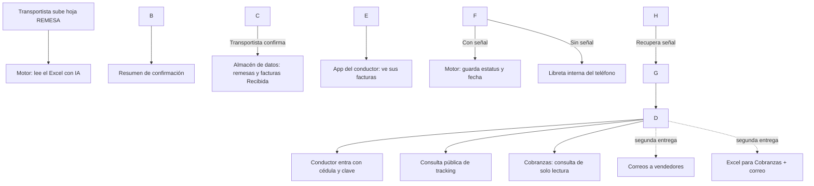

# PRD — Tracking Logístico

## 1\. Resumen ejecutivo

**Tracking Logístico** es un sistema para seguir cada factura desde que llega a Transporte hasta que se entrega o se devuelve al cliente. Funciona en computadora y en el teléfono del conductor (primero como página web instalable desde el navegador, y después como aplicación APK).

Transporte carga la hoja de Excel "REMESA", donde vienen los choferes, las placas, las rutas, las facturas y otros campos que se guardaran. El sistema la lee, crea las remesas y deja cada factura asignada a su conductor con el estatus **Recibida**. El conductor entra con su cédula y clave, ve solo sus facturas y las va marcando como **Cargado**, **En Tránsito**, **Entregada** o **Devolución**. Cada cambio guarda su fecha y hora, y en la entrega o devolución se toma una foto de la factura como comprobante.

Los vendedores pueden consultar el estado de una factura, sin usuario ni clave, con solo escribir el número de factura, de pedido o de tracking. Más adelante, Transporte enviará correos a los vendedores con el estatus de sus facturas y un correo a Cobranzas con un Excel idéntico al que usan hoy (Libro2), con el código de vendedor y el estatus final agregados.

**Objetivo a 90 días:** que las facturas tengan su estatus al día (meta propuesta: 95 % el mismo día), que los vendedores consulten ellos mismos y que Cobranzas reciba su Excel el mismo día en que se completan las entregas y tambien pueda consultar.

**Decisiones clave:**

* Empezar por una web instalable en el teléfono, o por la APK, para cumplir el plazo de 4 días.
* Claude lee el Excel directamente (por decisión del cliente), con un resumen de confirmación antes de guardar.
* Correos, Excel automático para Cobranzas y clientes quedan para una segunda entrega.

**TBD:** meta exacta del 95 %, nombre definitivo del producto.

\---

## 2\. Problema y oportunidad

**El problema hoy.** Transporte recibe las facturas, arma sus hojas de Excel (remesas) con el chofer, la placa y la ruta, y reparte la mercancía. Una vez que el camión sale, no hay un lugar único donde ver en qué estado está cada factura. Esto genera tres dolores a la vez:

* **No se sabe en qué estado está cada factura:** si salió, si va en camino, si se entregó o se devolvió.
* **Los vendedores preguntan por sus pedidos** y hay que averiguarlo a mano.
* **Se retrasan o se pierden facturas** y nadie se entera a tiempo. Cobranzas recibe la remesa de Transporte sin saber qué pasó realmente con cada factura.

**La oportunidad.** Un solo sistema donde cada factura tenga su estatus, su fecha y hora, y su comprobante (foto), visible en tiempo real para quien lo necesite. Así los vendedores se responden solos con la consulta pública, Transporte ve el avance de sus rutas, y Cobranzas recibe el Excel de entregas con la información ya confirmada.

**Qué NO intenta resolver esta primera versión:** el cálculo de rutas óptimas, la ubicación del camión en un mapa en vivo, la facturación ni los pagos.

**TBD:** línea base actual (consultas de vendedores por semana, % de facturas actualizadas el mismo día hoy) — se mide durante las primeras semanas de uso.

\---

## 3\. Usuario objetivo

|Quién|Su día a día|Qué hace en el sistema|¿Entra con clave?|
|-|-|-|-|
|**Transportista**|Recibe las facturas, arma las remesas y despacha los camiones|Carga la hoja REMESA y confirma el resumen, ve el avance de todas las remesas, edita datos de conductores y camiones, y (segunda entrega) envía los correos y genera el Excel de Cobranzas, puede cargar chofer modificar y eliminar, Tambien camiones cargar modificar y eliminar|Sí|
|**Conductor (chofer)**|Carga el camión, reparte y entrega en los clientes, casi siempre desde el teléfono|Ve solo sus facturas, las marca Cargado, En Tránsito, Entregada o Devolución, toma fotos, corrige sus propios datos (nombre, placa), y puede trabajar sin señal|Sí, con usuario y clave|
|**Supervisor**|Administra el sistema|Es el administrador: puede agregar y eliminar usuarios, conductores, camiones y datos sin restricciones|Sí|
|**Cobranzas**|Necesita saber qué facturas se entregaron para cobrarlas|Consulta los estatus (solo lectura) y recibe por correo el Excel de entregas (segunda entrega)|Sí|
|**Vendedor**|Quiere saber dónde está el pedido de su cliente|Consulta el tracking escribiendo factura, pedido o número de tracking|No|
|**Cliente final**|Recibe la mercancía|No usa el sistema; firma la factura al recibir|No aplica|

**Datos personales a proteger:** cédula y teléfono de los conductores. Solo los ve el Transportista, el Supervisor y el propio conductor (TBD: confirmar en detalle con seguridad).

\---

## 4\. Propuesta de valor

* **Transportista:** carga una sola vez su hoja REMESA y desde ahí el sistema lleva el control. Deja de armar seguimientos a mano y de contestar consultas sobre dónde está cada factura.
* **Conductor:** en el teléfono ve solo lo suyo y cambia un estatus con pocos toques, sin escribir datos ni llevar papeles de control aparte, incluso sin señal.
* **Vendedor:** sabe en segundos dónde está el pedido de su cliente, sin llamar ni escribir.
* **Cobranzas:** recibe el Excel con el mismo formato de siempre, ya con el estatus final y la fecha, lo que le permite empezar a cobrar sin esperar confirmaciones.
* **Supervisor:** administra todo el sistema desde un solo lugar.

**Qué lo hace distinto de seguir con solo Excel:** cada cambio de estatus queda con fecha y hora automáticas, hay un historial completo por factura, hay foto como comprobante, y los vendedores se atienden solos con la consulta pública.

\---

## 5\. Casos de uso principales

### 5.1 Cargar la remesa (Transportista)

* **Disparador:** llega una hoja Excel "REMESA" con las facturas del día.
* **Pasos:** el Transportista la sube → el sistema la lee (con IA) y arma un resumen (remesas, choferes, facturas, repetidos, datos faltantes) → el Transportista revisa y confirma → el sistema crea las remesas y deja cada factura en estatus **Recibida**, asignada a su conductor.
* **Resultado:** todas las facturas del día quedan en el sistema, listas para que cada conductor las vea.

### 5.2 Cambiar estatus en ruta (Conductor)

* **Disparador:** el conductor carga el camión con la mercancía de su remesa.
* **Pasos:** entra con cédula y clave → ve solo sus facturas → selecciona las que cargó y elige **Cargado** o **En Tránsito** (nace el número de tracking si aún no existía).
* **Resultado:** las facturas seleccionadas cambian de estatus con fecha y hora automáticas, con o sin señal.

### 5.3 Entregar o devolver (Conductor)

* **Disparador:** el conductor llega al cliente.
* **Pasos:** entrega la mercancía → marca **Entregada** (el sistema pregunta si quiere tomar foto de la factura con la firma del cliente) o, si no se puede entregar, marca **Devolución** y toma la foto de la factura con el motivo escrito.
* **Resultado:** la factura queda con su estatus final, fecha, hora y foto.

### 5.4 Consultar el tracking (Vendedor, sin clave)

* **Disparador:** un cliente le pregunta al vendedor por su pedido.
* **Pasos:** el vendedor entra a la página pública → escribe factura, pedido o tracking → el sistema muestra el estatus actual y el historial completo.
* **Resultado:** el vendedor responde en segundos, sin llamar a Transporte.

### 5.5 Generar el Excel para Cobranzas y avisar a vendedores *(segunda entrega)*

* **Disparador:** el Transportista decide notificar.
* **Pasos:** para vendedores, elige entre "facturas cargadas o en tránsito" o "facturas con estatus final" y el sistema envía el correo con solo el estatus; para Cobranzas, el sistema arma el Excel (igual al formato Libro2, con código de vendedor y estatus final) y lo envía adjunto.
* **Resultado:** vendedores y Cobranzas quedan al día sin que nadie escriba el correo a mano.

\---

## 6\. Recorrido del usuario

**Camino feliz (conductor):**

1. Abre la app en su teléfono y entra con cédula y clave.
2. Ve la lista de sus facturas de la remesa del día, con estatus **Recibida**.
3. Selecciona las que cargó en el camión y marca **Cargado**.
4. Sale a la ruta y las marca **En Tránsito**.
5. En cada cliente, marca **Entregada** (con foto opcional) o **Devolución** (con foto obligatoria del motivo).
6. Al terminar la ruta, todas sus facturas quedan con su historial completo.

**Cuando algo falla:**

* **No hay señal:** el cambio se guarda en el teléfono y se sube solo cuando recupera conexión.
* **El Excel viene con errores** (facturas repetidas, columnas faltantes, chofer sin registrar): el sistema los señala en el resumen antes de guardar, y el Transportista decide si corrige el archivo o continúa sin esas filas.
* **Un vendedor busca una factura que no existe:** el sistema muestra un mensaje claro ("no encontramos esa factura, pedido o tracking"), sin detalles internos.
* **Dos personas cambian el estatus de la misma factura al mismo tiempo:** gana el último cambio guardado (TBD: confirmar esta regla).

\---

## 7\. Qué hace la IA

|Tarea|Qué recibe|Qué produce|Qué NO debe hacer|
|-|-|-|-|
|**Leer la hoja REMESA**|El archivo Excel subido por el Transportista|Los datos de cada remesa (chofer, placa, ruta) y cada factura, listos para guardar, más un resumen de lo encontrado|No debe guardar nada sin que el Transportista confirme el resumen|
|**Detectar datos raros**|Los datos leídos del Excel|Avisos claros: facturas repetidas, chofer sin registrar, columnas vacías|No debe inventar un dato que falte|
|**Redactar los correos** *(segunda entrega)*|Lista de facturas y su estatus|Texto del correo a vendedores (solo estatus)|No debe agregar datos que no estén en la lista, ni prometer plazos|

**Todo lo demás** (estatus, fechas, historial, tracking, guardado sin señal, usuarios, consulta pública) es lógica de programa normal, sin IA, para que funcione siempre igual y sin costo por uso.

\---

## 8\. Construibilidad con Claude

**Se construye directamente con Claude:**

* Pantallas de carga del Excel, remesas, estatus, historial, usuarios y consulta pública.
* Lógica de estatus, fechas automáticas y generación del número de tracking.
* Lectura del Excel y detección de datos raros (con IA).
* Armado del Excel para Cobranzas y texto de los correos (segunda entrega).

**Requiere conexiones o conocimiento adicional:**

* **Servidor en internet (hosting):** para acceder desde cualquier lugar.
* **Base de datos con respaldos:** para guardar facturas, remesas, fotos e historiales sin perderlos.
* **Guardado sin señal en el teléfono ("modo offline"):** guarda los cambios en el teléfono y los sube solos al recuperar señal. Es la pieza más delicada del proyecto.
* **Servicio de correo:** para los avisos a vendedores y Cobranzas (segunda entrega).
* **Empaquetar la APK:** después de la primera entrega.
* **Seguridad de datos personales:** proteger cédulas y teléfonos de los conductores.

El cliente construye este sistema sola con Claude. Claude puede guiar paso a paso las conexiones externas, pero decisiones como elegir proveedor de hosting o correo y pagarlos las hace directamente el cliente.

**TBD:** elegir proveedor de hosting y de servicio de correo.

\---

## 9\. Alcance del MVP

|Prioridad|Funcionalidad|Esfuerzo|
|-|-|-|
|**Must (primera entrega, 4 días)**|Usuarios y claves (Transportista, Conductor, Supervisor)|Medio|
|**Must**|Carga de la hoja REMESA con resumen de confirmación|Medio|
|**Must**|App del conductor: ver sus facturas, cambiar estatus con fecha automática|Medio|
|**Must**|Guardado sin señal en el teléfono y subida automática al recuperar conexión|Grande|
|**Must**|Fotos de entrega y devolución|Medio|
|**Must**|Consulta pública de tracking|Rápido|
|**Should**|Cobranzas con acceso de solo consulta|Rápido|
|**Could (segunda entrega)**|Correos a vendedores|Medio|
|**Could (segunda entrega)**|Generación del Excel para Cobranzas y su correo|Medio|
|**Could (segunda entrega)**|Empaquetar la APK|Medio|
|**No por ahora**|Mapa en vivo del camión, cálculo automático de rutas, lectura automática (OCR) de la foto de la factura|—|

**Aviso honesto de plazo:** meter usuarios, carga del Excel, estatus, fotos, consulta pública **y** el guardado sin señal, todo desde cero, en 4 días, es un plazo muy ajustado. Lo más probable es que el primer día de uso real la app funcione bien con buena señal, y que el guardado sin señal necesite uno o dos días extra de ajuste después de las primeras pruebas con conductores reales.

\---

## 10\. Cómo se construye, en simple

Imagina el sistema como tres piezas que se hablan entre sí:

* **La app** (lo que ve la gente): pantallas en el navegador del teléfono o la computadora.
* **El motor** (el "cerebro"): recibe lo que hace cada persona (cargar el Excel, cambiar un estatus, consultar un tracking) y decide qué guardar y qué mostrar. Aquí vive también la parte de IA que lee el Excel.
* **El almacén de datos:** donde quedan guardadas las facturas, remesas, usuarios, fotos e historiales, con copias de respaldo.

El teléfono del conductor tiene además su propia "libreta" interna: cuando no hay señal, guarda ahí los cambios, y en cuanto vuelve la señal, se los envía al motor para que queden en el almacén central.

**TBD:** proveedor de hosting y de base de datos.

\---

## 11\. Métricas de éxito

**Métrica estrella:** porcentaje de facturas con su estatus actualizado el mismo día en que se mueven.

* **Meta a 90 días:** 95 % (TBD: ajustar con datos reales de la operación).
* **Línea base:** por definir en la primera semana de uso real.

**Métricas de apoyo:**

1. **Vendedores autónomos:** consultas públicas de tracking por semana vs. preguntas directas a Transporte (meta: que las consultas públicas superen ampliamente a las preguntas directas hacia el mes 2).
2. **Cobranzas al día:** tiempo entre estatus final y envío del Excel a Cobranzas (meta: mismo día, una vez en producción).
3. **Uso real del guardado sin señal:** % de cambios guardados sin señal que se suben correctamente después (meta: 100 %).

\---

## 12\. Riesgos y cómo evitarlos

|Riesgo|Probabilidad|Qué hacer|
|-|-|-|
|El guardado sin señal falla o duplica/pierde datos al subir|Alta|Priorizarlo primero, probarlo a fondo con conductores reales, avisar en pantalla qué falta por subir|
|El plazo de 4 días no alcanza para todo el Must|Alta|Sale primero lo que funcione con buena señal; el modo sin señal se ajusta en los días siguientes|
|El Excel llega con errores (facturas repetidas, chofer sin registrar, columnas movidas)|Media|Resumen de confirmación antes de guardar; el Transportista decide corregir o continuar|
|Se filtran datos personales de los conductores (cédula, teléfono)|Media|Restringir quién los ve (Transportista, Supervisor, el propio conductor); acceso con clave|
|El vendedor ve datos que no debería (montos, cédulas) en la consulta pública|Media|Mostrar solo estatus, fechas y datos generales; nunca montos ni cédulas|
|Se pierden fotos de entrega o devolución por fallas de conexión|Media|Guardar la foto también en la "libreta" del teléfono hasta confirmar que subió bien|
|Costos de IA suben con Excel muy grandes (miles de filas)|Baja|Leer por tandas; avisar costo estimado antes de procesar archivos muy grandes|
|Dos personas cambian el estatus de la misma factura al mismo tiempo|Baja|Regla clara (propuesta: gana el último cambio guardado), visible en el historial|

\---

## 13\. Plan 30 / 60 / 90 días

* **Días 1 a 4 (primera entrega):** usuarios y claves, carga de la hoja REMESA con resumen de confirmación, app del conductor con estatus y fotos, guardado sin señal, consulta pública. Prueba con un conductor real y una remesa real.
* **Días 5 a 15:** ajustar el guardado sin señal según lo que falle en el uso real; sumar el acceso de Cobranzas de solo lectura.
* **Día 30:** sistema en uso diario por todos los conductores, con el guardado sin señal estable.
* **Día 60:** construir correos a vendedores, Excel para Cobranzas y su correo automático.
* **Día 90:** revisar métricas de éxito y decidir si se construye la APK y si se agrega OCR de la foto de la factura.

\---

## Primeros pasos con Claude

1. **Pide a Claude que arme la estructura base del sistema:** la parte de usuarios y claves (Transportista, Conductor, Supervisor), tomando este PRD como referencia.
2. **Sube tu hoja REMESA real (sin datos sensibles si prefieres probar primero con datos de ejemplo)** y pide a Claude que construya la lectura del Excel con el resumen de confirmación.
3. **Construye la app del conductor** empezando por el camino con buena señal (ver facturas, cambiar estatus, fotos), y solo después añade el guardado sin señal, probándolo mucho antes de darlo por terminado.
4. **Define contigo misma (o con ayuda técnica) dónde vivirá el sistema** (proveedor de hosting) antes del día 1, para no perder tiempo del plazo de 4 días resolviendo esto sobre la marcha.
5. **Prueba con un conductor real y una remesa real** lo antes posible, incluso antes de tener todo terminado — así detectas los problemas del modo sin señal cuando todavía hay tiempo de ajustarlos.

