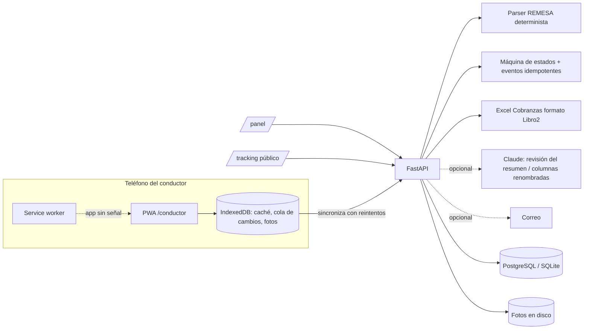

# Tracking Logístico

Seguimiento de cada factura desde que llega a Transporte hasta que se **entrega** o se **devuelve**.
Transporte carga la hoja **REMESA**, el conductor cambia estatus desde el teléfono (incluso **sin señal**),
los vendedores consultan sin clave y Cobranzas descarga su Excel con el formato de siempre (Libro2).

| Quién | Dónde entra | Qué hace |
|---|---|---|
| Supervisor | `/panel` | Todo, incluidos usuarios y borrado de remesas |
| Transportista | `/panel` | Carga REMESA, conductores, camiones, vendedores, correcciones, Excel/correos |
| Cobranzas | `/panel` | Solo lectura + Excel de entregas (no ve cédulas ni teléfonos) |
| Conductor | `/conductor` (PWA instalable) | Ve solo sus facturas; Por Entregar → Entregada / Devolución con foto |
| Vendedor | `/tracking` (sin clave) | Consulta por factura, pedido o tracking (sin montos ni datos personales) |

---

## 1. Puesta en marcha rápida

> **Publicar en internet con Vercel**: vea **[DESPLIEGUE_VERCEL.md](DESPLIEGUE_VERCEL.md)**
> (un comando en Windows: `powershell -ExecutionPolicy Bypass -File scripts\deploy_vercel.ps1`).
> **APK para Android**: vea **[APK_ANDROID.md](APK_ANDROID.md)**.

### Windows (desarrollo / prueba local)

```powershell
powershell -ExecutionPolicy Bypass -File scripts\setup.ps1
.\.venv\Scripts\tracking.exe crear-supervisor          # pide la clave
powershell -File scripts\run_dev.ps1                     # http://localhost:8000
```

### Linux / macOS

```bash
bash scripts/setup.sh
.venv/bin/tracking crear-supervisor
bash scripts/run_dev.sh
```

### Producción con Docker (PostgreSQL + HTTPS + respaldos)

```bash
cp .env.example .env      # complete SECRET_KEY, POSTGRES_PASSWORD, DOMAIN, BOOTSTRAP_ADMIN_PASSWORD
docker compose up -d --build
docker compose exec app tracking crear-supervisor   # si no definió BOOTSTRAP_ADMIN_PASSWORD
```

> **HTTPS es obligatorio en producción**: los navegadores solo permiten el modo sin señal (service
> worker) y la instalación de la app en sitios `https://`. El `docker-compose.yml` incluye Caddy, que
> obtiene el certificado automáticamente para `DOMAIN`.

Respaldos: el servicio `backup` guarda cada 24 h un `pg_dump` en `./backups` (retención
`BACKUP_RETENTION_DAYS`) y copia incremental de las fotos. Restaurar:
`pg_restore -h <host> -U tracking -d tracking --clean backups/tracking_AAAAMMDD_HHMM.dump`.

## 2. Primer uso

1. Entrar a `/panel` como supervisor y crear las **Empresas** de transporte (pestaña *Empresas*). Cada
   Transportista y Conductor pertenece a una; solo ve y opera los datos de la suya (ver 4c).
2. **Conductores → Cargar desde Excel**: elija la empresa y suba `REMESA.xlsx` (hoja `PLACAS`). Crea conductores y camiones
   y muestra **una sola vez** las claves temporales (imprímalas). El conductor entra con su **cédula**
   y se le pide crear su clave personal.
3. **Vendedores → Cargar desde Excel**: suba `Listado Codigo Vendedores.xlsx`; agregue correos si
   usará los avisos.
4. **Cargar REMESA**: suba el libro, revise el resumen (avisos, choferes sin registrar, remesas
   nuevas), elija qué remesas cargar (por defecto las nuevas; use *Solo desde* para no cargar el
   histórico del año) y confirme. Las facturas quedan en **Recibida**, asignadas a su conductor.
5. El conductor abre `https://<dominio>/conductor` en el teléfono → menú del navegador →
   *Agregar a pantalla de inicio*.

Lo mismo por línea de comandos:

```bash
tracking cargar-placas REMESA.xlsx --empresa 1
tracking cargar-vendedores "Listado Codigo Vendedores.xlsx"
tracking importar-remesa REMESA.xlsx                       # solo resumen
tracking importar-remesa REMESA.xlsx --confirmar --desde 2026-09-20 --registrar-choferes --empresa 1
```

## 3. Arquitectura



| Módulo | Responsabilidad |
|---|---|
| `services/remesa_parser.py` | Lee bloques `Chofer/Placa/Destino + tabla` por *streaming* (openpyxl read-only); tolera columnas movidas, empezar en A o B, números de remesa en distintas columnas, `#N/A`, facturas numéricas. Nunca inventa datos. |
| `services/importer.py` | Vista previa (no escribe) → confirmación idempotente (únicos por número de remesa y factura). Re-evalúa contra la base al confirmar. |
| `services/status.py` | Reglas de estatus, idempotencia por UUID del dispositivo, eventos tardíos del modo sin señal. |
| `web/outbox.js` | "Libreta interna": cola en IndexedDB, fotos guardadas hasta confirmar la subida, *backoff* exponencial. |
| `services/cobranzas_excel.py` | Excel idéntico a Libro2 (columnas B–N) + Cod. Vendedor, Estatus y Fecha del estatus. |
| `services/ai.py` | Opcional (`AI_REVIEW_ENABLED`). Reintentos con *backoff*; si falla, todo sigue funcionando. |

### Decisiones sobre los TBD del PRD

- **Lectura del Excel**: parser determinista como fuente de verdad (gratis, repetible, 2.000 facturas en
  segundos). La IA solo *comenta* el resumen y sugiere a qué campo corresponde una columna renombrada;
  la sugerencia se valida contra una lista cerrada y se muestra antes de confirmar.
- **Concurrencia**: todo cambio queda en el historial. Un cambio que **avanza** la factura siempre se
  aplica (aunque llegue tarde desde el modo sin señal). Entre Entregada y Devolución **gana el cambio
  más reciente** (hora en que ocurrió). Retroceder solo lo hace Supervisor/Transportista, con motivo.
- **Tracking**: nace al salir de Recibida, formato `TR-XXXXXXXX` (sin I/L/O/U para dictarlo fácil).
- **Factura repetida**: si ya está en el sistema se omite; si su último estatus es Devolución se carga
  como reenvío. Remesas sin número reciben un código estable `SN-…` (recargar no duplica).
- **Datos personales**: cédula y teléfono solo para Supervisor, Transportista y el propio conductor.
  La consulta pública no muestra montos, cédulas, teléfonos ni fotos y tiene límite por IP.
- **Métrica estrella** (`/api/reportes/metricas` y pestaña Inicio): % de cambios registrados el mismo
  día en que ocurrieron, cambios sin señal sincronizados y consultas públicas.

### Hallazgos en la REMESA real (para corregir en origen)

24 remesas sin número, la remesa `2025-00783` usada por dos choferes distintos, `2025-00794` con todas
sus facturas repetidas de otra remesa, 18 filas de factura repetidas y 3 filas sin número de factura.
El sistema las señala en el resumen antes de guardar.

## 4. API

Documentación interactiva en `/api/docs`. Principales rutas:

| Ruta | Uso |
|---|---|
| `POST /api/auth/login` | Usuario o cédula + clave → JWT |
| `POST /api/importaciones` → `POST /api/importaciones/{id}/confirmar` | Carga REMESA en dos pasos |
| `GET /api/conductor/facturas`, `POST /api/conductor/eventos` | App del conductor (lotes idempotentes) |
| `GET /api/conductor/remesas`, `POST /api/conductor/facturas/{id}/{tipo}` | Alcance del conductor (ver 4b) |
| `POST /api/admin/usuarios/{id}/clave`, `GET /api/admin/auditoria` | Claves y auditoría (ver 4b) |
| `PUT /api/fotos/{uuid}` | Foto de entrega/devolución (idempotente) |
| `GET /api/publico/tracking?q=` | Consulta pública (incluye evidencia PoD en Entregada/Devolución) |
| `GET /api/publico/evidencias/{foto}?exp=&sig=` | Foto PoD por enlace pre-firmado y temporal |
| `GET·POST /api/admin/empresas`, `GET·PATCH·DELETE /api/admin/empresas/{id}` | Empresas de transporte (solo Supervisor) |
| `GET /api/reportes/cobranzas.xlsx` | Excel para Cobranzas |
| `POST /api/reportes/notificar/vendedores` · `/cobranzas` | Correos (`simular: true` para vista previa) |

## 4b. Roles y permisos (RBAC)

Fuente única: `src/tracking/permissions.py` (enum `Permiso` + `MATRIZ` por rol). Los endpoints
declaran el permiso con `require_permission(...)`; las reglas que dependen de los datos están en
`validar_creacion` y `validar_gestion_clave`. Cada usuario puede consultar los suyos en `GET /api/me/permisos`.

| Capacidad | SUPERVISOR | TRANSPORTISTA | COBRANZAS | CONDUCTOR |
|---|:-:|:-:|:-:|:-:|
| Gestionar **Empresas** de transporte (CRUD) | ✔ | — | — | — |
| Ver remesas/facturas y reportes | todas | **solo su empresa** | todas | — |
| Importar REMESA, reasignar, corregir estatus, notificar | ✔ | ✔ | — | — |
| Crear usuarios **CONDUCTOR** | ✔ (configurable) | ✔ | — | — |
| Crear/editar usuarios de oficina | ✔ | — | — | — |
| Restablecer o fijar clave | cualquier usuario | solo conductores | — | — |
| Estado de credencial y bitácora de auditoría | ✔ | — | — | — |
| Ver **sus** remesas y facturas | — | — | — | ✔ |
| Registrar Carga, Salida, Entrega, Devolución en **sus** facturas | — | — | — | ✔ |
| Cambiar su propia clave (`/api/me/clave`) | ✔ | ✔ | ✔ | ✔ |

**Quién crea conductores** — variable `CONDUCTOR_CREATOR_ROLES` (por defecto `supervisor,transportista`).
Para que *solo el TRANSPORTISTA* pueda: `CONDUCTOR_CREATOR_ROLES=transportista`. Cualquier otro rol recibe
**403** «Solo TRANSPORTISTA puede crear usuarios con rol CONDUCTOR» (también al registrar choferes desde
la REMESA o la hoja PLACAS).

**Claves** — se guardan con Argon2id y **no se pueden ver** (ni el supervisor). En su lugar:

- `POST /api/admin/usuarios/{id}/clave` (supervisor) y `POST /api/admin/conductores/{id}/clave`
  (supervisor o transportista): sin cuerpo genera una clave temporal que se muestra **una sola vez**;
  con `{"clave_nueva": "...", "debe_cambiar_clave": true}` fija una. En ambos casos se cierran las sesiones abiertas
  del usuario y se obliga a cambiarla al entrar.
- `GET /api/admin/usuarios/{id}/credencial`: algoritmo, fecha y autor del último cambio, si debe
  cambiarla — nunca el hash.
- `GET /api/admin/auditoria`: quién creó usuarios, restableció claves o consultó credenciales.
- Las respuestas `/api/` llevan `Cache-Control: no-store` y los logs ocultan cualquier campo con
  nombre sensible (`clave`, `password`, `token`, `hash`…).

**Conductor** — solo `/api/conductor/*` (sus remesas, sus facturas, sus fotos) y su cuenta. Rutas nuevas:
`GET /api/conductor/remesas`, `GET /api/conductor/remesas/{id}`, `GET /api/conductor/facturas/{id}`,
`POST /api/conductor/facturas/{id}/{carga|salida|entrega|devolucion}`. Una remesa o factura ajena
responde **404**; otro estatus (p. ej. volver a *Recibida*) responde **422**. Ya no edita su ficha
(nombre/placa/teléfono): lo corrige la oficina.

Prueba manual rápida (con el servidor en marcha):

```bash
T=$(curl -s -X POST localhost:8000/api/auth/login -H 'content-type: application/json' \
     -d '{"username":"transportista1","password":"..."}' | python -c "import sys,json;print(json.load(sys.stdin)['access_token'])")
curl -s localhost:8000/api/me/permisos -H "authorization: Bearer $T"
curl -s -X POST localhost:8000/api/admin/conductores -H "authorization: Bearer $T" \
     -H 'content-type: application/json' -d '{"cedula":"V12345678","nombre":"Pedro Pérez","placa":"A12BC3D"}'
```

Pruebas automáticas de esta parte: `pytest tests/test_rbac.py -v` (matriz, jerarquía de creación,
política «solo transportista», claves y auditoría sin secretos, alcance del conductor y un recorrido de
**todas** las rutas de la API comprobando que el conductor recibe 403 fuera de su alcance).

## 4c. Multi-tenant (empresas de transporte) y evidencia fotográfica (PoD)

**Modelo**: tabla `empresas`; `usuarios.empresa_id`, `remesas.empresa_id`, `facturas.empresa_id`
(desnormalizada desde la remesa) e `importaciones.empresa_id` (migración `0004`). TRANSPORTISTA y
CONDUCTOR **deben** tener empresa; SUPERVISOR y COBRANZAS son globales. Una remesa nace en la empresa de
su conductor. Al migrar una base existente se crea «EMPRESA PRINCIPAL» con todo lo actual (nadie pierde acceso).

**Aislamiento** (`src/tracking/tenancy.py` + `src/tracking/repositories.py`), en dos capas:

1. *Repositorios inyectados*: los endpoints piden `Depends(get_facturas)` / `get_remesas` /
   `get_importaciones` / `get_conductores`; toda consulta parte de `repo.consulta()`, que ya trae
   `WHERE empresa_id = <empresa del usuario>`. Un id de otra empresa responde **404**.
2. *Red de seguridad en la sesión ORM*: al autenticar se vincula el `TenantScope` a la sesión; el evento
   `do_orm_execute` añade `with_loader_criteria(...)` a **todo** SELECT/UPDATE/DELETE (incluye
   `Session.get`, lazy loads y subconsultas) y `before_flush` sella `empresa_id` en filas nuevas y bloquea
   escrituras en filas ajenas. Las comprobaciones de sistema que deben cruzar empresas (unicidad del
   tracking o del número de remesa) lo piden explícitamente con `execution_options(**TODAS_LAS_EMPRESAS)`.

Cargas: un Transportista solo importa en su empresa; remesas, choferes o facturas de otra empresa se
excluyen sin revelar sus datos. Desactivar una empresa corta el acceso de todos sus usuarios.

**Proof of Delivery**: al aplicarse *Entregada* o *Devolución* con foto, `facturas.evidencia_foto_id`
apunta a ella (`fotos.capturada_at` guarda la hora de captura del teléfono; `fotos.url_externa` queda
para un object storage futuro). La consulta pública devuelve `evidencia: {url, expira_at, estatus,
content_type, capturada_at}` con una **URL pre-firmada HMAC** de vida corta: no expone el id interno de
forma permanente y se revoca sola si Transporte corrige el estatus. Variables:
`PUBLIC_EVIDENCE_ENABLED` (por defecto `true`) y `EVIDENCE_URL_TTL_MINUTES` (por defecto 30).

## 4d. Captura de facturas por foto (OCR) y reporte de Cobranzas en pantalla

**Foto de factura** (pestaña *Cargar REMESA* → «Tomar Foto de Factura»). Pipeline:

1. **OCR gratuito en el dispositivo** (por defecto, sin cuentas ni pagos): el navegador lee la foto con
   **PaddleOCR** (modelos PP-OCRv3 en formato ONNX, Apache-2.0) ejecutados con **ONNX Runtime Web**
   (MIT) — `web/ocr-local.js`, archivos en `web/vendor/` (~28 MB en partes de 3 MB, se descargan una
   sola vez y quedan en la caché del navegador). Una red detecta cada frase (con su inclinación) y otra
   la lee; el navegador envía cada frase con su **posición** (*cajas*) y el texto por renglones.
   *Opcional:* con `ANTHROPIC_API_KEY` la lectura la hace un modelo de visión (de pago).
2. La imagen se guarda siempre (`capturas_factura`, migración `0005`); el servidor interpreta el texto
   por posición (`parsear_cajas`: «FACTURA» → número de debajo; «Subtotal», «Base Imponible» → monto de
   la derecha, descartando los montos en Bs) y completa con expresiones tolerantes a errores de OCR
   (`parsear_texto_factura`): «PEO-»/«FED-» → «PED-», «DDD» → «000», coma decimal perdida
   (`$9405000` → 940,5000), año con un 6 leído como 8 (fecha futura → año actual, marcado a revisar).
   Si el cliente se parece mucho a uno ya registrado, se propone el nombre registrado.
3. Normalización determinista (montos `1.090,98`, fecha `DD-MM-AAAA`, descuento `5 %` → `0.05`) y reglas
   de coherencia (neto = total × (1 − descuento), fecha futura, duplicados, vendedor desconocido).
4. El operador revisa el formulario (los campos con confianza < 80 % se resaltan), elige **conductor** y
   remesa (abierta del conductor o nueva) y confirma: `POST /api/capturas/{id}/confirmar` crea la factura
   en *Recibida*. Se conservan `datos_extraidos` (IA) y `datos_validados` (humano) para medir la precisión.

**Flujo instantáneo:** al abrir *Cargar REMESA* se precargan el lector y los conductores. Al tomar la
foto el formulario aparece de inmediato; la subida y la lectura corren en paralelo y los campos se
rellenan solos por partes (`POST /api/capturas/{id}/lectura`: encabezado → pie → resto), sin pisar lo
que el operador ya escribió. El servidor envía las cabeceras COOP/COEP para que el lector use varios
hilos del procesador. Las rutas `/static/vendor/` no pasan por el *service worker* (caché HTTP, 7 días).

El OCR gratuito acierta mejor con fotos de frente, nítidas y con buena luz; lo que no lea queda vacío y
resaltado para completarlo a mano. Si el dispositivo no puede leer (navegador muy antiguo), la foto se
guarda igual y se transcribe.

> Desde la v1.17 «Cargado» y la *Fecha Car* ya no existen y los nombres cambiaron: ver la sección 4g.

**Fechas de cada etapa de la factura (fecha y hora):** *Fecha Alm*, *Fecha Rec*, *Fecha Car* y *Fecha Tra*
guardan fecha **y hora** (en UTC; se muestran en hora local). *Fecha Fac* sigue siendo solo el día impreso
en la factura. Al registrar una factura por foto, *Fecha Alm* y *Fecha Rec* toman el momento del registro.
*Fecha Car* se guarda cuando la factura pasa a **Cargado** y *Fecha Tra* cuando pasa a **En Tránsito**
(momento en que lo marcó el conductor, aunque llegue luego sin señal). Si se salta una etapa, la saltada
toma el mismo momento; si Transporte retrocede el estatus, se borran las fechas de las etapas por delante.
Del Excel de REMESA solo llega el día: queda a las 00:00 locales y se muestra sin hora. Migraciones `0006`
(columnas nuevas) y `0007` (fecha y hora; rellena Car/Tra con la hora exacta del historial).

**Cobranzas en pantalla** («Visualizar por pantalla»): `GET /api/reportes/cobranzas` devuelve la misma
selección y las mismas columnas que el Excel (fuente única en `cobranzas_excel.py`), con orden por
columna, paginación, totales y filtros por cliente y conductor; el Excel acepta los mismos filtros.

## 4e. Rol Consultor (solo consulta)

El **Consultor** ve todo el sistema y todas las empresas (Inicio con la métrica estrella, Cargar REMESA,
Remesas, Facturas, Conductores, Camiones, Vendedores, Usuarios, Empresas, Cobranzas y reportes con
métricas, Auditoría), con cédulas y teléfonos. Ve también **todos los botones** del Supervisor (Nuevo,
Editar, Eliminar, Cargar REMESA, Corregir estatus, Reasignar, Enviar correos…), pero al usarlos aparece:
*«Este usuario es Consultor: solo puede consultar. No puede agregar, modificar ni eliminar.»*

Puede: consultar, descargar el Excel de Cobranzas, ver la vista previa de los correos a vendedores,
cambiar su propia clave y, en *Cargar REMESA*, **tomar la foto de una factura** (se extraen y muestran
todos los datos y avisos, pero ni la foto ni la factura se guardan: `POST /api/capturas/analizar`) y
**analizar hojas de remesas** (mismo resumen que la carga normal, sin guardar:
`POST /api/importaciones/analizar` y `/analizar-archivo`). «Registrar factura» y «Confirmar y cargar»
muestran el aviso de solo consulta. Lo crea el Supervisor en *Usuarios* (rol «Consultor»).

Cómo se garantiza: `/api/me/permisos` devuelve `permisos` (reales, de lectura) y `permisos_interfaz`
(los del Supervisor, solo para dibujar botones); `common.js` detiene cualquier cambio con el aviso, y el
servidor (`security.get_current_user`) rechaza con 403 y el mismo mensaje toda petición que no sea de
lectura, salvo su clave y la vista previa de correos.

## 4f. Reingresos, observación de entrega, Activo Sí/No y Bitácora (v1.15)

* **Reingreso por devolución**: una factura en *Devolución* queda **habilitada para reingreso**. Al cargarla de
  nuevo (Excel o foto) en una remesa posterior se crea un **nuevo ciclo** (`facturas.reingreso_de_id` → la
  devuelta), con su propio tracking e historial; la devuelta conserva el suyo. El detalle muestra ambos ciclos.
* **Observación de la entrega**: el conductor puede escribirla al marcar *Entregada* (igual que el motivo de una
  devolución). Queda en `eventos_estatus.motivo` (con hora, conductor y foto) y la vigente en
  `facturas.observacion_entrega`; se ve en el detalle de la factura, en la app del conductor y en la consulta pública.
* **Usuarios para el Transportista**: ve el menú *Usuarios* solo con los **conductores de su empresa**; puede
  restablecer su clave y cambiar **Activo (Sí/No)**. El Supervisor cambia Activo a cualquiera (menos a sí mismo):
  `POST /api/admin/usuarios/{id}/activo`. Con **No** se cierran sus sesiones al instante y el login responde
  «Su usuario está inactivo…» hasta que vuelva a **Sí**.
* **Bitácora** (*Auditoría → Bitácora*): cada petición de un usuario identificado (`CONSULTAR`, `CREAR`,
  `MODIFICAR`, `ELIMINAR`), `LOGIN`/`LOGIN_FALLIDO`/`LOGOUT` y las pantallas abiertas (`VISTA`), con fecha y hora,
  usuario, rol, empresa, ruta, módulo, resultado HTTP, IP, duración y el payload saneado (sin claves). Tabla
  `bitacora` **inmutable** (trigger que rechaza UPDATE/DELETE; migración `0008`). La sincronización automática del
  teléfono del conductor (cabecera `X-Sincronizacion`) no se registra como consulta.
* **Archivo de la bitácora** (*Auditoría → Bitácora → Archivo*, solo Supervisor): saca un **mes o un año ya
  terminado** de la tabla activa y lo guarda comprimido (JSON Lines + gzip, con SHA-256) en `bitacora_archivos`
  (migración `0009`), en una sola transacción: si algo falla no se borra nada. El trigger de inmutabilidad solo
  permite ese borrado dentro del archivado; los archivos tampoco se modifican. Se descargan en **CSV (Excel)** o en
  su formato original. Un período no se archiva dos veces, ni un año con meses ya archivados. Por línea de
  comandos (para programarlo): `tracking archivar-bitacora --mes 2026-09`, `--anio 2025` o
  `--automatico 3` (archiva todos los meses cerrados y deja los últimos 3 en la bitácora activa).
* **Pie de la pantalla de inicio**: «Versión X.X.X · Octubre 2026» (`/api/config`: `version_publica`,
  `fecha_creacion`; configurables con `VERSION_PUBLICA` y `FECHA_CREACION`).

## 4g. Flujo Preparado → Por Entregar → Entregada, montos por rol y días entre procesos (v1.17)

* **Estatus**: «Recibida» se llama **Preparado** y «En Tránsito» **Por Entregar** (los valores internos
  `recibida` / `en_transito` no cambian). **«Cargado» se eliminó** de la base, la lógica y las pantallas; el
  conductor solo tiene el botón **Por Entregar** (y luego Entregada / Devolución). Un «Cargado» que un teléfono
  con la versión anterior tenga guardado sin señal se registra como Por Entregar al sincronizar.
* **Fechas**: *Fecha Preparado* = `fecha_alm` (del Excel «Fecha Alm», o el momento del registro por foto);
  *Por Entregar* = `fecha_tra`; *Fecha Entregado (Fecha Rec)* = `fecha_rec`, que ahora se llena **solo** cuando
  la factura pasa a Entregada (vacía = «Por Entregar»; la «Fecha Rec» del Excel ya no se usa). Devolución o
  retroceso la vacían. *Fecha Car* se eliminó.
* **Montos** (Total factura / neto, %, flete): solo **Supervisor** y **Cobranzas** (permiso
  `facturas.montos.ver`). Para los demás roles la API los devuelve vacíos (`montos_visibles: false`) y el
  reporte de Cobranzas (pantalla y Excel) sale sin esas columnas. El Consultor tampoco los ve.
* **Días transcurridos entre procesos** (ficha de la factura, `tiempos` en `GET /api/facturas/{id}`): días
  calendario en hora local entre Fecha Factura → Fecha Preparado → Fecha Por Entregar → Fecha Entregado y
  **Total Días para la entrega** (suma). El tramo en curso cuenta hasta hoy; la devolución no tiene entrega.
* **Migración `0010`**: facturas en Cargado → Por Entregar (Fecha Por Entregar = su fecha de carga; su último
  evento Cargado queda como Por Entregar y el resto de eventos Cargado se borra); `fecha_rec` = momento de la
  entrega para las Entregadas y vacía para las demás; se borra la columna `fecha_car`.

## 4h. Tiempo hábil entre procesos, devoluciones e Indicador de Gestión (v1.18)

* **Fecha Preparado en el historial**: el evento «Preparado» lleva la *Fecha Alm* del Excel (00:00 locales) o,
  si la factura se dio de alta por foto, la hora en que se **tomó la foto** (`tomada_at` que manda el navegador;
  si falta o es absurda, la hora de subida). Si el Excel no trae Fecha Alm, el momento de la carga. Mientras la
  factura siga en Preparado, esa es también su *Fecha Estatus*. Migración `0011` corrige los datos existentes.
* **Devolución**: *Fecha Entregado* muestra «No entregada devolución - dd/mm/aaaa hh:mm». En los tiempos solo se
  mide *Por Entregar → Devolución*, con el mensaje «No se entregó - Devolución».
* **Tiempo hábil** (`services/tiempos.py`, desde la v1.20): solo cuenta la **jornada laboral de lunes a viernes de
  7:00 a 16:00** (hora local; configurable con `JORNADA_INICIO` / `JORNADA_FIN`), así que **un día = 9 horas**.
  Noches, fines de semana y lo que pase antes de las 7:00 o después de las 16:00 no suman (sin feriados). Menos de un día se muestra «3 h 05 min» (nunca «0 días»). El tramo en
  curso cuenta hasta ahora. Lo usan la ficha de la factura, la consulta pública (`tiempos` en
  `/api/publico/tracking`) y el Indicador de Gestión.
* **Indicador de Gestión** (Cobranzas y reportes, debajo de «Avisar a vendedores»; permiso `reportes.ver`):
  filtros por rango de fechas (Fecha Factura —por defecto—, Preparado, Entregado o Estatus), estatus (varios),
  cliente, vendedor, zona (= Destino de la remesa) y empresa de transporte. Tabla ordenable y paginada con
  KPIs, **SUMA** y **PROMEDIO** de cada tramo; **Imprimir** (todas las filas del filtro) y **Excel**
  (`/api/reportes/indicador.xlsx`, con columna numérica «Total (horas hábiles)»). Sin montos para quien no es
  Supervisor ni Cobranzas. API: `GET /api/reportes/indicador`, `/indicador/opciones`, `/indicador.xlsx`.

## 4i. Gráfica del Indicador de Gestión y Excel de 13 columnas (v1.19)

* **Gráfica** (`web/indicador-grafica.js`, Chart.js 4.4.7 servido desde `web/vendor/chartjs-4.4.7`, sin CDN):
  al pulsar «Visualizar por pantalla» aparece «Indicador de Gestión»: barras agrupadas con las **empresas de
  transporte** en el eje X y una serie por estatus (azul = Preparado, naranja = Por Entregar, gris = Entregada,
  rojo = Devolución). Sobre cada barra la cantidad de facturas en **negro** y su porcentaje (dentro de esa empresa
  de transporte) en **amarillo**, ambos en vertical dentro de la barra (estilo gráfico de Excel). Sigue a todos
  los filtros; en el teléfono las barras se dibujan horizontales.
* **Desglose**: clic en una barra → dona de ese estatus y esa empresa de transporte; clic en la leyenda → ese
  estatus en todas. Es una **dona 3D** (dibujo propio en canvas: relieve, brillo y sectores separados, números
  blancos grandes) cuyos sectores son las **empresas emisoras** con cantidad y porcentaje. «Imprimir» incluye la
  gráfica y, si está abierto, el desglose.
* Los datos llegan agregados en `grafica` de `GET /api/reportes/indicador` (todas las filas del filtro, no solo la
  página): `empresas[{nombre,total,cantidades,porcentajes}]` y `desglose[estatus][transporte|"*"]`.
* **Excel** (`/api/reportes/indicador.xlsx`): solo estas 13 columnas, en este orden, encabezados en la fila 1:
  Factura, Cliente, Estatus, Fecha de factura, Fecha último estatus, Tiempo de Facturado a Preparado, Tiempo de
  Preparado a Por Entregar, Tiempo de Por Entregar a Entregado o Devolución, Observación, Cod. Vendedor, Zona,
  Chofer, Empresa de transporte.

## 4j. Jornada de 9 horas y devoluciones en Entregado (v1.20)

* Todos los tiempos entre procesos (ficha de la factura, consulta pública, Indicador de Gestión en pantalla,
  impresión y Excel, sumas y promedios) usan la jornada laboral: lunes a viernes de 7:00 a 16:00, **día = 9 h**.
  Ejemplo: viernes 15:00 → lunes 9:00 = 3 h. El cuadro muestra «Días hábiles de 9 h: lunes a viernes de 7:00 a 16:00».
* En la gráfica del Indicador de Gestión las **devoluciones se suman a Entregado** (también en su desglose); la
  tabla y el Excel siguen mostrando el estatus real de cada factura.

## 4k. Feriados, selección con clic y filtros al instante (v1.21)

* **Feriados** (menú *Feriados*; tabla `feriados`, migración `0012`): no cuentan como días hábiles en ningún
  cálculo de tiempos. La migración carga los feriados nacionales de Venezuela de 2024 a 2030 (fijos + Carnaval y
  Semana Santa); el Supervisor puede agregar días (decretos), quitarlos o «Cargar feriados nacionales del año».
  API: `GET/POST /api/feriados`, `DELETE /api/feriados/{id}`, `POST /api/feriados/nacionales`.
* El cuadro de tiempos dice «Días hábiles: de lunes a viernes de 7:00 a 16:00».
* **Indicador de Gestión**: la tabla en pantalla (e impresión) muestra solo las 13 columnas del Excel. Clic en una
  barra (o en la leyenda) → la tabla muestra esas facturas (`serie` / `transporte`; Entregado incluye
  devoluciones) junto con el desglose; «Ver todas las facturas» vuelve al listado completo. Excel e impresión
  respetan la selección. Al cambiar cualquier filtro, gráfica, totales y tabla se actualizan solos.

## 4l. Clave temporal «qwerty» con 3 accesos (v1.22)

* Todo usuario o conductor nuevo, y toda clave restablecida, recibe la clave temporal `CLAVE_TEMPORAL`
  (por defecto `qwerty`; si se deja vacía, una aleatoria por usuario).
* Con ella puede entrar `ACCESOS_CLAVE_TEMPORAL` veces (por defecto 3). En cada ingreso ve el aviso con los accesos
  que le quedan y puede cambiarla en ese momento; en el panel y en la app del conductor queda un aviso fijo.
* Al cuarto ingreso solo puede crear su clave personal: el servidor rechaza cualquier otra petición (403) hasta
  que la cambie. La clave personal no puede ser la temporal. Migración `0013` (`usuarios.accesos_clave_temporal`).
* Seguridad: una clave temporal igual para todos es fácil de adivinar. Mitigan el riesgo el límite de intentos de
  ingreso, que solo sirve 3 veces y que el usuario recibe el aviso; para mayor seguridad, deje `CLAVE_TEMPORAL`
  vacía (claves aleatorias).

## 4m. Logo Fermetal (v1.22.1)

* El logo de la aplicación es el de **Fermetal** con el ícono del camión encima (`web/icons/logo.png`), en la
  pantalla de ingreso, el panel y la consulta pública. Los íconos de la app instalada y del navegador
  (`icon.svg`, `icon-192.png`, `icon-512.png`, `icon-maskable-512.png`) usan el mismo diseño.
  El logo original está en `web/icons/fermetal-original.png`.
* Pie: «Creado por Geison Villegas · vgeison@gmail.com · Para Fermetal».
* Si ya se generó el **APK**, hay que volver a generarlo para que tome el ícono nuevo.

## 4n. Inicializar la base de datos (v1.23)

* `..\Inicializar_BD_Tracking.bat` (en `C:\Desarrollo\Tracking - Octubre\`) ejecuta
  `python -m tracking.inicializar_bd`: **vacía** remesas, facturas (historial, fotos, capturas, cargas de Excel),
  conductores y sus usuarios, camiones, auditoría, bitácora (también la archivada) y consultas públicas;
  **conserva** empresas, vendedores, feriados y usuarios de oficina. Ver `..\LEEME_Inicializar_BD.txt`.
* Respaldo completo previo en `..\respaldos_bd\` (copia SQLite o JSON Lines de todas las tablas de Neon);
  las fotos en disco se mueven al respaldo. Una sola transacción, validada antes de confirmar (tablas en
  cero y huella SHA-256 de lo conservado); si falla, se deshace (código 2). `--simular` no cambia nada.
* Destinos: `local` (`DATABASE_URL` de `.env`) y `produccion` (`.env.local`, conexión directa de Neon).
  Desatendido: `Inicializar_BD_Tracking.bat produccion --si`. Queda un registro «base_inicializada» en Auditoría.

## 4o. Cargar REMESA con rango de «Fecha Fac» (v1.24)

* En **Cargar REMESA → Hoja REMESA (Excel)** hay dos fechas opcionales, **Desde** y **Hasta**, antes de
  **Analizar**. Solo se analizan y cargan las facturas cuya **Fecha Fac** está en ese rango (ambos días
  incluidos); las demás, y las que no tienen Fecha Fac, se ignoran en esa carga. Sin fechas = toda la hoja,
  exactamente como antes.
* El filtro se aplica en el parser (`RemesaParser(filtro=FiltroFechaFac(...))`) **antes** de las validaciones,
  así que duplicados, datos faltantes, clasificación (nueva / ya cargada / en otra remesa…), totales, avisos y
  la confirmación trabajan solo con el subconjunto. Las remesas sin ninguna factura en el rango no aparecen.
* API: `fecha_fac_desde` / `fecha_fac_hasta` en `POST /api/importaciones`, `/filas`, `/analizar` y
  `/analizar-archivo`. Desde > Hasta, o ningún resultado en el rango → 422 con las fechas Fac que trae la hoja.
* El resumen trae `filtro_fecha_fac` (rango, facturas en rango, fuera de rango, sin fecha, remesas ignoradas,
  Fecha Fac mínima y máxima de la hoja) y `facturas_detalle` (hasta 5.000 facturas del rango, sin montos), que la
  pantalla muestra en «Facturas en el rango» con buscador. «Cargas recientes» indica el rango usado.

## 4p. Empresa de transporte por remesa: solo el Supervisor la cambia, en cascada (v1.25)

* Remesas y Facturas (listados, detalle de la remesa y ficha de la factura) muestran la **Empresa de
  transporte** (`empresa_transporte` en la API). No confundir con la *empresa emisora* del Excel.
* Permiso `remesas.empresa_transporte.cambiar`: **solo SUPERVISOR** (el Consultor ve el botón, pero el servidor
  responde «solo consulta»; Transportista, Cobranzas y Conductor no lo tienen).
* `PUT /api/remesas/{id}/empresa-transporte` y `PUT /api/facturas/{id}/empresa-transporte`
  `{empresa_id, conductor_id?}`: en una transacción, `UPDATE` masivo de la remesa, de **todas** sus facturas
  (`empresa_id`, `conductor_id`) y de sus capturas por foto. Desde una factura se mueve toda su remesa.
  El conductor es opcional y debe ser de la empresa nueva; sin conductor, la remesa queda sin asignar y esa
  empresa la reasigna con «Reasignar». Valida empresa activa, conductor activo y de esa empresa, y que haya
  un cambio real (409). Queda en Auditoría como «empresa_transporte_cambiada».
* «Reasignar» a un conductor de otra empresa (solo Supervisor) usa la misma cascada.

## 4q. Entrar con la huella o el rostro del teléfono (v1.26)

* Estándar **WebAuthn** (llaves de acceso), con la librería `webauthn` (Duo Labs). La huella nunca sale del
  teléfono: este guarda una llave privada para el sitio y el servidor solo la llave **pública**
  (tabla `credenciales_biometricas`, migración `0014`). Se exige verificación del usuario (huella, rostro o PIN).
* **Activar**: después de entrar con usuario y clave, la pantalla de ingreso ofrece «Activar huella» (una vez
  por usuario y teléfono; «Ahora no» no vuelve a preguntar). El conductor también puede activarla o quitarla en
  «Mis datos». Activarla exige la clave actual y una clave personal (no la temporal).
* **Entrar**: si el teléfono tiene la huella activada, el ingreso muestra «Entrar con huella». Queda en la
  bitácora como `LOGIN` con `metodo: biometria`. Usuario inactivo: 403, igual que con la clave.
* **Seguridad**: retos de un solo uso que vencen en 3 minutos (tabla `retos_biometricos`, sirven en Vercel),
  firma verificada contra el dominio y el origen, contador anti-clonación y límite de intentos por IP.
  Al **restablecer la clave** de un usuario (Supervisor/Transportista) se borran todas sus huellas
  (teléfono perdido); queda en Auditoría como `biometria_eliminada`.
* API: `POST /api/auth/biometria/opciones` y `/ingreso` (anónimas); `POST /api/me/biometria/opciones`
  `{clave}`, `POST /api/me/biometria`, `GET /api/me/biometria`, `DELETE /api/me/biometria/{id}`.
* Requiere **https** (o `localhost`): por la IP de la red local (`http://192.168…`) el botón no aparece.
  Variables: `BIOMETRIA_HABILITADA`, `WEBAUTHN_RP_ID`, `WEBAUTHN_ORIGENES` (vacías = dominio de la app).

## 4r. Versión en el encabezado del panel (v1.26.1)

* El encabezado del panel muestra, junto a «Tracking Logístico», la versión y la fecha de creación
  («Versión 1.26.1 · Octubre 2026»), tomadas de `/api/config` igual que los pies de página.
* La pantalla de ingreso ya no muestra la línea de autoría («Creado por…»): solo la versión.

## 5. Pruebas y calidad

```bash
pytest                       # 78 pruebas: parser, flujo, permisos, multi-tenant, PoD, migraciones, OCR, reportes
TEST_DATABASE_URL=postgresql://usuario@localhost:5432/tracking_test pytest   # mismas pruebas en PostgreSQL
ruff check src tests && mypy # estilo y tipado estricto
```

## 6. Pendiente / siguientes pasos

- **APK**: la PWA ya es instalable; para publicar en Play Store se envuelve con Trusted Web Activity
  (Bubblewrap) o Capacitor sin reescribir la app.
- Activar correos: `EMAIL_ENABLED=true` + datos SMTP (proveedor por definir).
- Al publicar una versión nueva de la app web, subir `VERSION` en `src/tracking/web/sw.js` para que
  los teléfonos descarguen los archivos nuevos.
- Con varias réplicas del servidor, mover los límites de intentos/consultas a Redis o al proxy.
- Fuera de alcance de esta versión (PRD): mapa en vivo, rutas óptimas, OCR de la foto.
